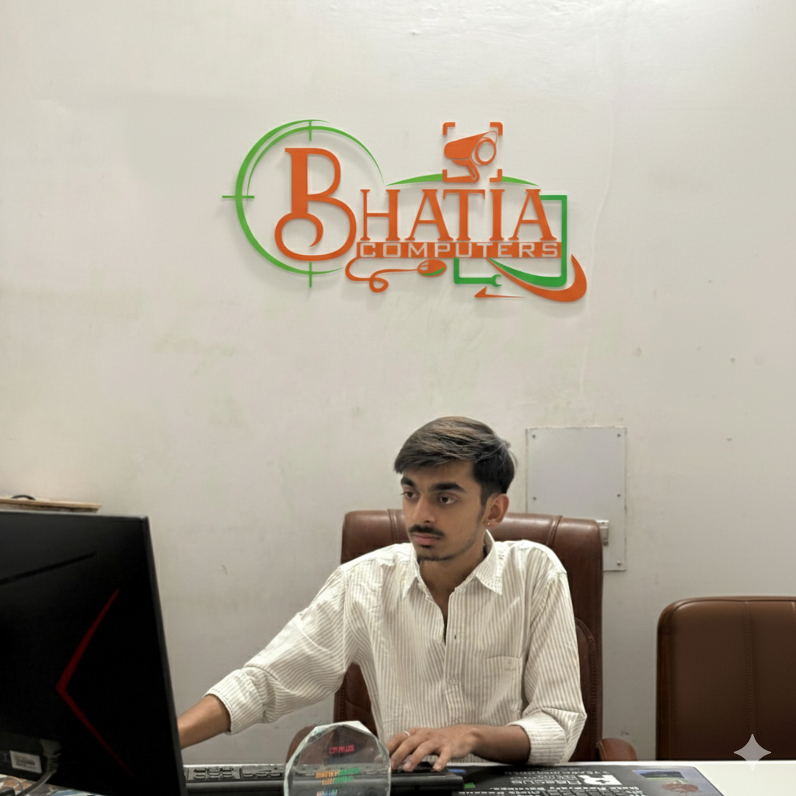

<!DOCTYPE html>
<html lang="en" class="scroll-smooth">
<head>
  <meta charset="UTF-8" />
  <meta name="viewport" content="width=device-width, initial-scale=1.0" />
  <title>Abhigyan Bhatia | Technologist & Solutions Architect</title>
  
  <!-- Inter & JetBrains Mono Fonts -->
  <link rel="preconnect" href="https://fonts.googleapis.com">
  <link rel="preconnect" href="https://fonts.gstatic.com" crossorigin>
  <link href="https://fonts.googleapis.com/css2?family=Inter:wght@300;400;500;600;700;800;900&family=JetBrains+Mono:wght@400;500;700&display=swap" rel="stylesheet">
  
  <!-- Font Awesome Icons -->
  <link rel="stylesheet" href="https://cdnjs.cloudflare.com/ajax/libs/font-awesome/6.5.1/css/all.min.css" />
  
  <!-- Tailwind CSS CDN -->
  
  
  

  
</head>

<body class="bg-brand-dark text-slate-200 antialiased selection:bg-brand-cyan/20 selection:text-brand-cyan relative overflow-x-hidden font-sans">

  <!-- Ambient Light Orbs -->
  

  

  

  <!-- Toast Notification Container -->
  

  <!-- Navigation Bar -->
  <header class="fixed top-0 left-0 right-0 z-40 px-4 py-3 transition-all duration-300" id="main-header">
    

      <!-- Logo / Name -->
      <a href="#hero" class="flex items-center gap-3 group">
      
        

          Abhigyan Bhatia
          IoT & Software Architect
        

      </a>

      <!-- Desktop Nav Links -->
      <nav class="hidden md:flex items-center gap-8 text-sm font-medium text-slate-300">
        <a href="#about" class="hover:text-brand-cyan transition-colors">About</a>
        <a href="#experience" class="hover:text-brand-cyan transition-colors">Experience</a>
        <a href="#projects" class="hover:text-brand-cyan transition-colors">Projects</a>
        <a href="#skills" class="hover:text-brand-cyan transition-colors">Skills</a>
        <a href="#achievements" class="hover:text-brand-cyan transition-colors">Milestones</a>
        <a href="#future" class="hover:text-brand-cyan transition-colors">Vision</a>
      </nav>

      <!-- Right CTAs -->
      

        <button onclick="copyEmailToClipboard()" class="text-xs font-mono py-2 px-3.5 rounded-lg border border-slate-700 bg-slate-800/80 hover:border-brand-cyan/50 hover:bg-slate-800 text-slate-200 transition-all flex items-center gap-2">
          <i class="fa-regular fa-copy text-brand-cyan"></i>
          Copy Email
        </button>
        <a href="#contact" class="text-xs font-semibold py-2 px-4 rounded-lg bg-gradient-to-r from-brand-cyan to-brand-blue text-slate-950 hover:opacity-90 transition-all shadow-glow-cyan">
          Let's Connect
        </a>
      

      <!-- Mobile Hamburger Button -->
      <button id="mobile-toggle" class="md:hidden text-slate-300 hover:text-white p-2 focus:outline-none">
        <i class="fa-solid fa-bars-staggered text-xl"></i>
      </button>
    

    <!-- Mobile Drawer Menu -->
    

      <a href="#about" class="text-slate-300 hover:text-brand-cyan py-1" onclick="toggleMenu()">About</a>
      <a href="#experience" class="text-slate-300 hover:text-brand-cyan py-1" onclick="toggleMenu()">Experience</a>
      <a href="#projects" class="text-slate-300 hover:text-brand-cyan py-1" onclick="toggleMenu()">Projects</a>
      <a href="#skills" class="text-slate-300 hover:text-brand-cyan py-1" onclick="toggleMenu()">Skills</a>
      <a href="#achievements" class="text-slate-300 hover:text-brand-cyan py-1" onclick="toggleMenu()">Achievements</a>
      <a href="#future" class="text-slate-300 hover:text-brand-cyan py-1" onclick="toggleMenu()">Future Vision</a>
      <a href="#contact" class="text-brand-cyan font-semibold py-2" onclick="toggleMenu()">Contact Me</a>
    

  </header>

  <main class="relative z-10 pt-28">

    <!-- HERO SECTION -->
    <section id="hero" class="max-w-7xl mx-auto px-4 sm:px-6 lg:px-8 py-16 md:py-24">
      

        
        <!-- Left Hero Content -->
        

          <!-- Availability Tag -->
          

            
              
              
            
            Open for Enterprise CCTV,Networking & Bulk IT Supply
          

          <h1 class="text-4xl sm:text-5xl lg:text-6xl font-black text-white tracking-tight leading-[1.15]">
            "Powering  Enterprise Security with Bulk IT Hardware Solutions"
          </h1>

          

            Hi, I’m <strong class="text-white font-semibold">Abhigyan Bhatia</strong> — Currently pursuing  diploma in Computer Engineering while managing operations at Bhatia Computers & Electronics.

          

          <!-- Core Role Badges -->
          

            <i class="fa-solid fa-gamepad text-cyan-400 mr-1.5"></i>IT & Networking
            <i class="fa-solid fa-video text-blue-400 mr-1.5"></i>Enterprise CCTV & Security
            <i class="fa-solid fa-microchip text-purple-400 mr-1.5"></i>Sales & Marketing
            <i class="fa-solid fa-users text-emerald-400 mr-1.5"></i>NSS Volunteer & General Secretary"Damla Polythenic Youth Club
          

          <!-- Hero Buttons -->
          

            <a href="#projects" class="px-6 py-3 rounded-xl bg-gradient-to-r from-brand-cyan to-brand-blue text-slate-950 font-bold hover:shadow-glow-cyan hover:scale-[1.02] transition-all text-sm flex items-center gap-2">
              <i class="fa-solid fa-diagram-project"></i>
              Explore My Work
            </a>
            <a href="#experience" class="px-6 py-3 rounded-xl bg-slate-800/80 hover:bg-slate-700/80 text-white font-medium border border-slate-700 hover:border-slate-500 transition-all text-sm flex items-center gap-2">
              <i class="fa-solid fa-timeline"></i>
              View Experience
            </a>
            <a href="Abhigyan_Bhatia_Resume.pdf" download="Abhigyan_Bhatia_Resume.pdf" class="px-5 py-3 rounded-xl glass-card text-slate-300 hover:text-white font-medium text-sm flex items-center gap-2 hover:border-cyan-500/40">
              <i class="fa-solid fa-file-arrow-down text-brand-cyan"></i>
              Curriculum Vitae
            </a>
          

          <!-- Quick Stats Counter -->
          

            

              
10+

              
Production Systems

            

            

              
500+

              
Hardware Nodes

            

            

              
Top 3

              
Hackathon Finalist

            

            

              
100%

              
Hands-On Ownership

            

          

        

        <!-- Right Visual / Terminal Card -->
        

          

            <!-- Terminal Header -->
            

              

                
                
                
                abhigyan@systems:~
              

              <i class="fa-solid fa-shield-halved mr-1"></i>SECURE
            

            <!-- Terminal Output -->
            

              
root@core:~$ initialize-profile --name "Abhigyan Bhatia"

              
>> Institution: Seth Jai Prakash Polytechnic, Damla

              
>> Current Role: Sr. Manager, Bhatia Computers & Electronics

              
>> Core Focus: CCTV Networks, IoT Nodes, Full-Stack Architecture

              
>> Key Projects: [TrustCam Haryana, Kisan Cool Pod, Sarthi Sync]

              
>> Youth Leadership: General Secretary (Youth Club), NSS Star Volunteer

              
              

                

                  Hardware & Physical Deployments
                  95%
                

                

                  

                

                

                  Cross-Platform Flutter & Web Engine
                  90%
                

                

                  

                

              

            

            <!-- Quick Action Interactive Badge inside Card -->
            

              

                

                  <i class="fa-solid fa-satellite-dish"></i>
                

                

                  
Live Operations Node

                  
Yamunanagar & Chandpur Hub

                

              

              ONLINE
            

          

        

      

    </section>

    <!-- ABOUT SECTION -->
    <section id="about" class="max-w-7xl mx-auto px-4 sm:px-6 lg:px-8 py-20 border-t border-slate-800/60">
      

        // Origin & Philosophy
        <h2 class="text-3xl sm:text-4xl font-extrabold text-white">Engineering from the Bare Metal to Modern Cloud Apps.</h2>
      

      

        <!-- Card 1 -->
        

          

            <i class="fa-solid fa-microchip"></i>
          

          <h3 class="text-lg font-bold text-white mb-2">Hardware-Grounded</h3>
          

            Unlike software developers who stay purely in code editors, I spend hours deploying real NVRs, CP Plus & Dahua IP cameras, wireless outdoor bridges, and microcontroller sensor nodes. I build software with deep respect for physical constraints.
          

        

        <!-- Card 2 -->
        

          

            <i class="fa-solid fa-layer-group"></i>
          

          <h3 class="text-lg font-bold text-white mb-2">Full-Stack & Mobile</h3>
          

            Skilled in cross-platform Flutter application development, Python (Flask), and dynamic PHP/MySQL databases. From designing payroll applications to cloud-synced dispatch systems, I construct resilient client-server infrastructures.
          

        

        <!-- Card 3 -->
        

          

            <i class="fa-solid fa-hand-holding-heart"></i>
          

          <h3 class="text-lg font-bold text-white mb-2">Community & Leadership</h3>
          

            Leading as General Secretary of the Youth Club and recognized as NSS Star & Best Volunteer. I organize multi-department esports tourneys, technical workshops, blood donation drives, and public governance youth parliaments.
          

        

      

    </section>

    <!-- EXPERIENCE & ROLES SECTION -->
    <section id="experience" class="max-w-7xl mx-auto px-4 sm:px-6 lg:px-8 py-20 border-t border-slate-800/60">
      

        

          // Proven Track Record
          <h2 class="text-3xl sm:text-4xl font-extrabold text-white">Experience & Leadership Journey</h2>
        

        

          Bridging technical enterprise execution with campus community governance and state conventions.
        

      

      <!-- Timeline Component -->
      

        
        <!-- Experience Item 1: Bhatia Computers -->
        

          

          
          

            2024 – PRESENT
          

          

            

              <h3 class="text-xl font-bold text-white flex items-center gap-2">
                Senior Manager & Solutions Engineer
                Current Role
              </h3>
              July 2024 – Present
            

            
Bhatia Computers & Electronics — Yamunanagar, Haryana

            <ul class="text-sm text-slate-300 space-y-2 list-disc list-inside">
              <li>Directing enterprise IT operations, client technical consulting, and security hardware deployments across residential and commercial establishments.</li>
              <li>Engineered 50+ site-specific IP/HD CCTV surveillance layouts (CP Plus, Dahua, Hikvision) paired with high-throughput Tenda and CPE wireless bridges.</li>
              <li>Spearheaded inventory management, vendor negotiations, and customized software systems for retail billing, attendance, and technical job tracking.</li>
            </ul>
            

              Enterprise CCTV
              Wireless Bridges
              Network Topology
              Client Consulting
            

          

        

        <!-- Experience Item 2: Youth Club GS -->
        

          

          
          

            2026
          

          

            

              <h3 class="text-xl font-bold text-white">General Secretary — Youth Club</h3>
              2026
            

            
Seth Jai Prakash Polytechnic, Damla

            

              Serving as the highest executive student officer within the institution’s Youth Club, driving student mobilization, technical culture, and inter-collegiate events.
            

            <ul class="text-sm text-slate-300 space-y-1.5 list-disc list-inside">
              <li>Pioneered and managed the official campus <em>Free Fire MAX Esports Championship</em> with 100+ competitors, customized live casting, and rules enforcement.</li>
              <li>Co-ordinated the institutional phase of Smart India Hackathon (SIH 2026), mentoring first-year cohorts in pitch formation and prototype viability.</li>
            </ul>
          

        

        <!-- Experience Item 3: NSS Volunteer -->
        

          

          
          

            2025 – 2026
          

          

            

              <h3 class="text-xl font-bold text-white">Star & Best Volunteer — National Service Scheme (NSS)</h3>
              2025 – 2026
            

            
Ministry of Youth Affairs and Sports | Damla Chapter

            

              Awarded both <strong class="text-white">Best Volunteer</strong> and <strong class="text-white">Star Volunteer</strong> honors at the intensive 7-Day Annual Residential NSS Camp.
            

            <ul class="text-sm text-slate-300 space-y-1.5 list-disc list-inside">
              <li>Organized massive district blood donation drives in partnership with Red Cross Society and civil hospitals.</li>
              <li>Supervised digital literacy workshops for rural school students in adopted surrounding villages.</li>
            </ul>
          

        

      

    </section>

    <!-- PROJECTS SECTION (Filterable) -->
    <section id="projects" class="max-w-7xl mx-auto px-4 sm:px-6 lg:px-8 py-20 border-t border-slate-800/60">
      

        

          // Built For Utility
          <h2 class="text-3xl sm:text-4xl font-extrabold text-white">Flagship Engineering Projects</h2>
        

        
        <!-- Filter Buttons -->
        

          <button data-filter="all" class="filter-btn active px-3.5 py-1.5 rounded-lg text-xs font-mono font-semibold bg-brand-cyan text-slate-950 transition-all">All Projects</button>
          <button data-filter="iot" class="filter-btn px-3.5 py-1.5 rounded-lg text-xs font-mono text-slate-300 bg-slate-800/80 hover:bg-slate-700 transition-all">IoT & Hardware</button>
          <button data-filter="software" class="filter-btn px-3.5 py-1.5 rounded-lg text-xs font-mono text-slate-300 bg-slate-800/80 hover:bg-slate-700 transition-all">Software & Cloud</button>
          <button data-filter="hackathon" class="filter-btn px-3.5 py-1.5 rounded-lg text-xs font-mono text-slate-300 bg-slate-800/80 hover:bg-slate-700 transition-all">Hackathon Finalists</button>
        

      

      <!-- Project Cards Grid -->
      

        <!-- Project 1: TrustCam Haryana -->
        

          

            

              Security Platform
              
<i class="fa-solid fa-arrow-up-right-from-square"></i>

            

            <h3 class="text-xl font-bold text-white mb-2">TrustCam Haryana</h3>
            

              A comprehensive state-aligned registry and certification verification platform connecting verified CCTV technicians, enterprise hardware vendors, and citizen security audits.
            

          

          

            

              Flutter
              Firebase
              CCTV Protocols
              REST API
            

            <button onclick="openModal('TrustCam Haryana', 'A verified technician framework developed to prevent unauthorized surveillance tampering, standardize installation pricing across Yamunanagar district, and provide authenticated tamper-proof logs for security cameras.', ['Full Flutter Mobile App', 'QR-based Field Inspection Audits', 'Geo-tagged Technician Certification'])" class="text-xs font-semibold text-brand-cyan hover:underline flex items-center gap-1.5">
              View Architecture Details <i class="fa-solid fa-arrow-right text-[10px]"></i>
            </button>
          

        

        <!-- Project 2: Kisan Cool Pod -->
        

          

            

              Hack Orbit Finalist
              <i class="fa-solid fa-award mr-1"></i>Awarded
            

            <h3 class="text-xl font-bold text-white mb-2">Kisan Cool Pod (Cool Kisan)</h3>
            

              Decentralized, micro-cold storage architecture with IoT thermal telemetry and remote humidity control built specifically for perishable vegetable farmers in Haryana.
            

          

          

            

              ESP32 / Arduino
              DHT22 Sensors
              Solar Inverter IoT
              Python Analytics
            

            <button onclick="openModal('Kisan Cool Pod (Hack Orbit Finalist)', 'Recognized in the top echelon of Hack Orbit 2026 at Mukand Lal National College. Solves the 30% harvest spoil cycle in Yamunanagar tomato & cauliflower farmers using low-cost sensor telemetry and localized cooling relays.', ['Micro-Cold Chamber Telemetry', 'SMS Alert on Threshold Spikes', 'Solar Battery Level Tracking'])" class="text-xs font-semibold text-brand-purple hover:underline flex items-center gap-1.5 text-purple-400">
              View Architecture Details <i class="fa-solid fa-arrow-right text-[10px]"></i>
            </button>
          

        

        <!-- Project 3: Sarthi Sync -->
        

          

            

              Smart Mobility
              
<i class="fa-solid fa-arrow-up-right-from-square"></i>

            

            <h3 class="text-xl font-bold text-white mb-2">Sarthi Sync / Rural Bus Tracker</h3>
            

              Hardware-in-the-loop transit solution providing low-latency bus positioning, stop estimates, and SMS schedules for rural commuters across Chandpur-Yamunanagar transit lines.
            

          

          

            

              NEO-6M GPS
              GSM SIM800L
              Flask Backend
              Leaflet Maps
            

            <button onclick="openModal('Sarthi Sync Transit', 'Engineered to bridge rural students and elderly villagers who lack high-speed 5G. Provides real-time geolocation with both web mapping and fallback GSM SMS inquiry system.', ['Sub-3-second GPS updates', 'Low data bandwidth telemetry', 'Village kiosk display compatibility'])" class="text-xs font-semibold text-blue-400 hover:underline flex items-center gap-1.5">
              View Architecture Details <i class="fa-solid fa-arrow-right text-[10px]"></i>
            </button>
          

        

        <!-- Project 4: Staff Attendance & Payroll Suite -->
        

          

            

              Enterprise Software
              Deployed In Retail
            

            <h3 class="text-xl font-bold text-white mb-2">Retail Attendance & Payroll Suite</h3>
            

              Custom-built cross-platform application managing biometric log-ins, store shifts, overtime computation, and automated monthly pay slip generation.
            

          

          

            

              Flutter Desktop
              MySQL Database
              PDF Generator
              Local Auth
            

            <button onclick="openModal('Retail Attendance & Payroll Suite', 'Eliminated manual register logs at Bhatia Computers & Electronics. Tracks technician on-field visits, salary advances, and tax deductions with one-click exportable PDF payroll slips.', ['Zero Cloud Downtime fallback', 'Role-based access security', 'Seamless local thermal printer hook'])" class="text-xs font-semibold text-emerald-400 hover:underline flex items-center gap-1.5">
              View Architecture Details <i class="fa-solid fa-arrow-right text-[10px]"></i>
            </button>
          

        

        <!-- Project 5: Abhi Mansion & Digital Commerce -->
        

          

            

              Full-Stack Web
              
<i class="fa-solid fa-arrow-up-right-from-square"></i>

            

            <h3 class="text-xl font-bold text-white mb-2">Abhi Mansion & Digital Portal</h3>
            

              Full-featured dynamic web application featuring booking workflows, inventory catalogs, service inquiry dashboards, and responsive front-end interfaces.
            

          

          

            

              PHP 8
              MySQL
              Tailwind/Bootstrap
              Admin Control
            

            <button onclick="openModal('Abhi Mansion & Digital Commerce', 'End-to-end web portal featuring complete CRUD functionality, custom authentication, database normalization, and instant quote generation.', ['Custom PHP Model-View controllers', 'SQL injection immunization', 'Mobile-first responsive design'])" class="text-xs font-semibold text-cyan-400 hover:underline flex items-center gap-1.5">
              View Architecture Details <i class="fa-solid fa-arrow-right text-[10px]"></i>
            </button>
          

        

        <!-- Project 6: Campus SIH & Esports Portal -->
        

          

            

              Community Platform
              Institutional Event
            

            <h3 class="text-xl font-bold text-white mb-2">Polytechnic Esports & Hackathon Desk</h3>
            

              Custom scoring, team matchmaking, and bracket tournament management platform for intra-college competitive gaming and SIH preliminary rounds.
            

          

          

            

              JavaScript
              Live JSON Scoring
              Google Cloud API
            

            <button onclick="openModal('Polytechnic Tournament & Hackathon Desk', 'Streamlined registrations and automated kill-point bracket evaluations for 32 squads during the Free Fire MAX championship organized under the Youth Club.', ['Instant scoreboard rendering', 'Verification of player IDs', 'Automated lobby notifications'])" class="text-xs font-semibold text-purple-400 hover:underline flex items-center gap-1.5">
              View Architecture Details <i class="fa-solid fa-arrow-right text-[10px]"></i>
            </button>
          

        

      

    </section>

    <!-- TECHNICAL SKILLS MATRIX -->
    <section id="skills" class="max-w-7xl mx-auto px-4 sm:px-6 lg:px-8 py-20 border-t border-slate-800/60">
      

        // Technical Weaponry
        <h2 class="text-3xl sm:text-4xl font-extrabold text-white">Full-Stack & Hardware Matrix</h2>
      

      

        
        <!-- Category 1: Languages & Frameworks -->
        

          

            <i class="fa-solid fa-code text-cyan-400 text-xl"></i>
            <h3 class="font-bold text-white text-base">Languages & App Dev</h3>
          

          

            

              

                Flutter / Dart
                Advanced
              

              

            

            

              

                Python (Flask / Scripting)
                Proficient
              

              

            

            

              

                PHP 8 & Modern MVC
                Proficient
              

              

            

            

              

                C & Core Java
                Academic Core
              

              

            

            

              

                JavaScript & HTML5/Tailwind
                High
              

              

            

          

        

        <!-- Category 2: Hardware & Surveillance Networks -->
        

          

            <i class="fa-solid fa-network-wired text-blue-400 text-xl"></i>
            <h3 class="font-bold text-white text-base">Surveillance & Infra</h3>
          

          

            

              

                Enterprise CCTV (Dahua / CP Plus)
                Mastery
              

              

            

            

              

                NVR / DVR Remote P2P & DDNS
                Mastery
              

              

            

            

              

                Outdoor CPE Wireless Bridges
                High
              

              

            

            

              

                Tenda / Mikrotik Routing & VLANs
                High
              

              

            

          

        

        <!-- Category 3: IoT, Embedded & Cloud -->
        

          

            <i class="fa-solid fa-satellite text-purple-400 text-xl"></i>
            <h3 class="font-bold text-white text-base">IoT, GPS & Backend</h3>
          

          

            

              

                ESP32, Arduino, Microcontrollers
                Advanced
              

              

            

            

              

                GPS Modules (NEO-6M) & GSM
                Advanced
              

              

            

            

              

                MySQL & Relational Design
                High
              

              

            

            

              

                Firebase & Firestore Realtime
                Proficient
              

              

            

          

        

        <!-- Category 4: Tools, Leadership & Media -->
        

          

            <i class="fa-solid fa-compass-drafting text-emerald-400 text-xl"></i>
            <h3 class="font-bold text-white text-base">Workflows & Leadership</h3>
          

          

            

              

                Git / GitHub Versioning
                Everyday
              

              

            

            

              

                Public Speaking & Debating
                Awarded
              

              

            

            

              

                Canva, Adobe UI & Video Media
                High
              

              

            

            

              

                Team Mentorship & Event Ops
                Experienced
              

              

            

          

        

      

    </section>

    <!-- ACHIEVEMENTS & HONORS SHOWCASE -->
    <section id="achievements" class="max-w-7xl mx-auto px-4 sm:px-6 lg:px-8 py-20 border-t border-slate-800/60">
      

        // Honors & Credentials
        <h2 class="text-3xl sm:text-4xl font-extrabold text-white">Recognitions & Milestone Badges</h2>
      

      

        
        <!-- Achievement 1 -->
        

          

            <i class="fa-solid fa-trophy"></i>
          

          

            Hackathon Honors • Oct 2026
            <h4 class="text-base font-bold text-white mb-1">Finalist — Hack Orbit Inter-College</h4>
            

              Mukand Lal National College, Yamunanagar. Pitched the Kisan Cool Pod smart agriculture micro-storage IoT project among 40+ competitor teams.
            

          

        

        <!-- Achievement 2 -->
        

          

            <i class="fa-solid fa-landmark"></i>
          

          

            Governance & Oratory • Sep 2026
            <h4 class="text-base font-bold text-white mb-1">Union Minister of Finance (Treasury)</h4>
            

              JMIT Radaur Inter-College Youth Parliament. Defended national budget policy from the Treasury benches; received commendation from jury judges.
            

          

        

        <!-- Achievement 3 -->
        

          

            <i class="fa-solid fa-handshake-angle"></i>
          

          

            State Convention • Oct 2026
            <h4 class="text-base font-bold text-white mb-1">State Delegate — Sewa Sankalp Haryana</h4>
            

              Selected delegate at the DAV Girls College & Kurukshetra University State Convention for grassroots community contribution and youth leadership.
            

          

        

        <!-- Achievement 4 -->
        

          

            <i class="fa-solid fa-star"></i>
          

          

            NSS Award • Mar 2026
            <h4 class="text-base font-bold text-white mb-1">Best Volunteer & Star Volunteer</h4>
            

              Awarded both honors at the 7-day residential camp of Seth Jai Prakash Polytechnic for exceptional organizational efficiency and social impact.
            

          

        

        <!-- Achievement 5 -->
        

          

            <i class="fa-solid fa-certificate"></i>
          

          

            Global Certifications
            <h4 class="text-base font-bold text-white mb-1">UNICEF YuWaah & HP LIFE Certified</h4>
            

              Certified in Artificial Intelligence Productivity & Data Tools (UNICEF YuWaah), Critical Thinking & Professional Business Networking (HP LIFE Foundation).
            

          

        

        <!-- Achievement 6 -->
        

          

            <i class="fa-solid fa-gamepad"></i>
          

          

            Campus Sports Ops • Oct 2026
            <h4 class="text-base font-bold text-white mb-1">Head Convener — Intra Esports Championship</h4>
            

              Conceptualized and executed the first campus-wide Free Fire MAX championship with live streaming, rules arbitrations, and prize ceremonies.
            

          

        

      

    </section>

    <!-- FUTURE VISION SECTION -->
    <section id="future" class="max-w-7xl mx-auto px-4 sm:px-6 lg:px-8 py-20 border-t border-slate-800/60">
      

        

        

          // The Road Ahead
          <h2 class="text-3xl sm:text-4xl font-extrabold text-white mb-4">Vision, Future Research & Aspirations</h2>
          

            Technology yields its highest dividend when it solves structural issues outside Tier-1 metros. My trajectory is focused on three high-leverage domains:
          

          

            

              <i class="fa-solid fa-circle-check text-cyan-400 mt-1"></i>
              

                <strong class="text-white">Edge AI Computer Vision for Regional Surveillance:</strong> Moving beyond passive recording to on-device neural detection of intrusion, traffic density, and safety anomalies without high cloud bandwidth dependency.
              

            

            

              <i class="fa-solid fa-circle-check text-cyan-400 mt-1"></i>
              

                <strong class="text-white">Decentralized Cold Chain Logistics:</strong> Expanding the <em class="text-white">Kisan Cool Pod</em> prototype into commercially viable solar units to prevent localized post-harvest perishable wastage.
              

            

            

              <i class="fa-solid fa-circle-check text-cyan-400 mt-1"></i>
              

                <strong class="text-white">High-Speed Rural Mesh Networks:</strong> Deploying cost-effective unlicensed Wi-Fi bridges and low-power telemetry to modernize transit, education, and village security.
              

            

          

        

      

    </section>

    <!-- CONTACT & CONNECT SECTION -->
    <section id="contact" class="max-w-7xl mx-auto px-4 sm:px-6 lg:px-8 py-20 border-t border-slate-800/60">
      

        
        <!-- Left Contact Info -->
        

          // Direct Frequency
          <h2 class="text-3xl sm:text-4xl font-extrabold text-white">Let’s Architect Something Significant Together.</h2>
          

            Whether you represent a tech company seeking an adaptable engineer with physical hardware & full-stack software fluency, an enterprise needing surveillance design, or a hackathon team aiming for victory — reach out directly.
          

          <!-- Contact items -->
          

            

              

                <i class="fa-solid fa-location-dot"></i>
              

              

                
Headquarters / Base

                
Yamunanagar & Chandpur, Haryana, India

              

            

            

              

                <i class="fa-solid fa-envelope"></i>
              

              

                
Official Electronic Mail

                
abhigyanbhatia.tech@gmail.com

              

              <i class="fa-regular fa-copy text-slate-400 text-xs pr-2"></i>
            

            

              

                <i class="fa-solid fa-building-user"></i>
              

              

                
Enterprise Office

                
Bhatia Computers & Electronics, Yamunanagar

              

            

          

          <!-- Social Quick Links -->
          

            <a href="https://github.com" target="_blank" rel="noopener" class="w-10 h-10 rounded-xl glass-card flex items-center justify-center text-slate-300 hover:text-white hover:border-cyan-400 transition-colors">
              <i class="fa-brands fa-github text-lg"></i>
            </a>
            <a href="https://linkedin.com" target="_blank" rel="noopener" class="w-10 h-10 rounded-xl glass-card flex items-center justify-center text-slate-300 hover:text-white hover:border-cyan-400 transition-colors">
              <i class="fa-brands fa-linkedin text-lg"></i>
            </a>
            <a href="https://twitter.com" target="_blank" rel="noopener" class="w-10 h-10 rounded-xl glass-card flex items-center justify-center text-slate-300 hover:text-white hover:border-cyan-400 transition-colors">
              <i class="fa-brands fa-x-twitter text-lg"></i>
            </a>
            <button onclick="copyEmailToClipboard()" class="w-10 h-10 rounded-xl glass-card flex items-center justify-center text-slate-300 hover:text-brand-cyan hover:border-cyan-400 transition-colors" title="Copy Email">
              <i class="fa-solid fa-at text-lg"></i>
            </button>
          

        

        <!-- Right Interactive Form -->
        

          

            <h3 class="text-xl font-bold text-white mb-2">Send an Instant Message</h3>
            
Inquiries typically answered within 4 hours.

            <form id="contact-form" onsubmit="handleFormSubmit(event)" class="space-y-4">
              

                

                  <label class="block text-xs font-mono text-slate-300 mb-1.5">Your Full Name *</label>
                  <input type="text" id="form-name" required placeholder="e.g. Vikram Sharma" class="w-full px-4 py-2.5 rounded-xl bg-slate-900/90 border border-slate-700 focus:border-brand-cyan focus:outline-none text-sm text-white placeholder-slate-500 transition-colors" />
                

                

                  <label class="block text-xs font-mono text-slate-300 mb-1.5">Email Address *</label>
                  <input type="email" id="form-email" required placeholder="name@domain.com" class="w-full px-4 py-2.5 rounded-xl bg-slate-900/90 border border-slate-700 focus:border-brand-cyan focus:outline-none text-sm text-white placeholder-slate-500 transition-colors" />
                

              

              

                <label class="block text-xs font-mono text-slate-300 mb-1.5">Project or Inquiry Domain</label>
                <select id="form-category" class="w-full px-4 py-2.5 rounded-xl bg-slate-900/90 border border-slate-700 focus:border-brand-cyan focus:outline-none text-sm text-white transition-colors">
                  <option value="Enterprise CCTV & Surveillance">Enterprise CCTV & Surveillance Network</option>
                  <option value="Full-Stack / Flutter Mobile Project">Full-Stack / Flutter Mobile Project</option>
                  <option value="IoT / Hardware Automation">IoT / Hardware Automation</option>
                  <option value="Hackathon / Collaboration">Hackathon Collaboration / Speaking</option>
                  <option value="General Technical Inquiry">General Technical Inquiry</option>
                </select>
              

              

                <label class="block text-xs font-mono text-slate-300 mb-1.5">Brief Message / Scope *</label>
                <textarea id="form-message" rows="4" required placeholder="Describe your requirement, timeline, or query..." class="w-full px-4 py-2.5 rounded-xl bg-slate-900/90 border border-slate-700 focus:border-brand-cyan focus:outline-none text-sm text-white placeholder-slate-500 transition-colors"></textarea>
              

              <button type="submit" id="form-submit-btn" class="w-full py-3.5 px-6 rounded-xl bg-gradient-to-r from-brand-cyan to-brand-blue text-slate-950 font-bold hover:shadow-glow-cyan hover:opacity-95 transition-all text-sm flex items-center justify-center gap-2">
                <i class="fa-solid fa-paper-plane"></i>
                Transmit Inquiry
              </button>
            </form>
          

        

      

    </section>

  </main>

  <!-- FOOTER -->
  <footer class="border-t border-slate-800/80 bg-slate-950/80 py-8 text-center text-xs text-slate-500">
    

      

        ABHIGYAN BHATIA
        •
        Yamunanagar, Haryana
      

      

        Engineered with precision. All rights reserved.
      

      

        System Status: Normal Operability
      

    

  </footer>

  <!-- ARCHITECTURE MODAL -->
  

    

      <button onclick="closeModal()" class="absolute top-4 right-4 text-slate-400 hover:text-white p-2">
        <i class="fa-solid fa-xmark text-lg"></i>
      </button>

      

        <i class="fa-solid fa-microchip"></i>
        PROJECT DOSSIER
      

      <h3 id="modal-title" class="text-xl font-bold text-white mb-3">Project Title</h3>
      
Project detailed technical overview...

      

        <h4 class="text-xs font-mono uppercase tracking-wider text-slate-400 mb-2">Key Technical Highlights:</h4>
        <ul id="modal-highlights" class="text-xs text-slate-300 space-y-1.5 list-disc list-inside"></ul>
      

      

        <button onclick="closeModal()" class="px-4 py-2 rounded-lg bg-slate-800 hover:bg-slate-700 text-xs font-semibold text-white">Close Dossier</button>
      

    

  

  <!-- JAVASCRIPT LOGIC -->
  
</body>
</html>
